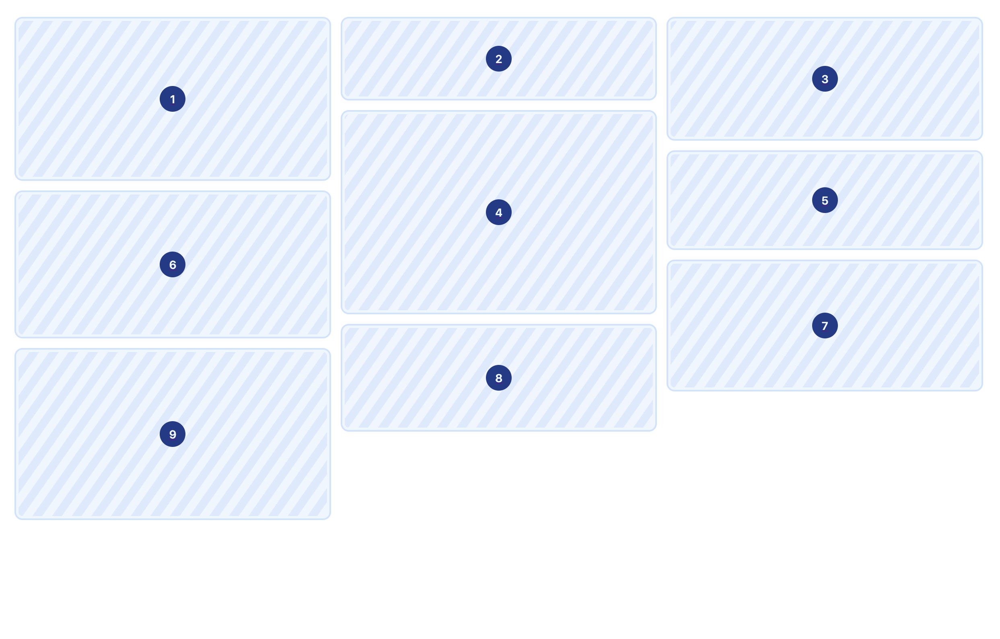
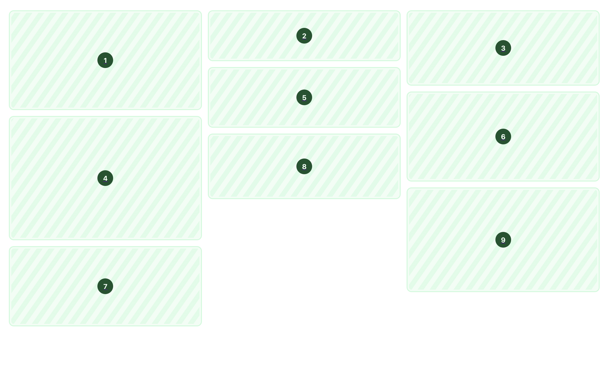
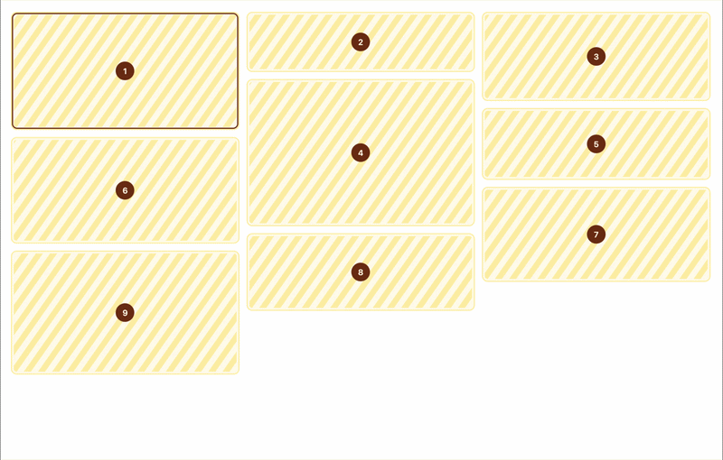

# Astro Masonry


A masonry grid for Astro. It puts each item into the shortest column, and changes the number of columns with the screen width. Keyboard users can move between the items with the arrow keys.

## Install

```bash
npm install @mannisto/astro-masonry
```

## Usage

```astro
---
import { Masonry } from "@mannisto/astro-masonry/components"
---

<Masonry autoColumns={280} columns={3}>
  {
    items.map((item) => {
      return <div>{item}</div>
    })
  }
</Masonry>
```

`autoColumns` sets the minimum width of a column, and the grid shows as many columns as fit. `columns` sets the maximum, here 3.

## Props

| Prop | Type | Default | Description |
|---|---|---|---|
| `columns` | `number` | `1` | The number of columns. With `autoColumns`, the maximum number of columns, and no maximum without it. |
| `gap` | `number \| string` | `"1rem"` | The space between the items. A number is in `px`. |
| `breakpoints` | `Record<number, number>` | — | The number of columns from a screen width, for example `{ 640: 2, 1024: 3 }`. |
| `autoColumns` | `number \| string` | — | The minimum width of a column. The grid shows as many columns as fit. A number is in `px`. |
| `sequential` | `boolean` | `false` | Puts the items in order, from left to right, in place of the shortest column. |
| `aria-label` | `string` | — | The `aria-label` of the grid. |
| `role` | `string` | — | The `role` of the grid. |
| `class` | `string` | — | The classes of the grid. |

## Examples

### Fixed columns

```astro
<Masonry columns={3}>
  {
    items.map((item) => {
      return <div>{item}</div>
    })
  }
</Masonry>
```


*Each item goes into the shortest column, so the columns stay about the same height.*

### Responsive columns

`columns` sets the number of columns on small screens. `breakpoints` changes it from a screen width in `px`.

```astro
<Masonry
  columns={1}
  breakpoints={{ 640: 2, 1024: 3 }}
>
  {
    items.map((item) => {
      return <div>{item}</div>
    })
  }
</Masonry>
```

### Columns from a minimum width

The grid shows as many columns as fit at the minimum width. When the width of the grid changes, the number of columns changes too.

```astro
<Masonry autoColumns={280}>
  {
    items.map((item) => {
      return <div>{item}</div>
    })
  }
</Masonry>
```

### Columns from a minimum width, with a maximum

With `autoColumns`, `columns` sets the maximum number of columns.

```astro
<Masonry
  autoColumns={280}
  columns={4}
>
  {
    items.map((item) => {
      return <div>{item}</div>
    })
  }
</Masonry>
```

### Columns from a minimum width, with a maximum for each screen width

With `autoColumns`, `breakpoints` changes the maximum from a screen width.

```astro
<Masonry
  autoColumns={280}
  columns={1}
  breakpoints={{ 640: 2, 1024: 4 }}
>
  {
    items.map((item) => {
      return <div>{item}</div>
    })
  }
</Masonry>
```

### Sequential order

The items go in order, from left to right and then down. Use it when the order of the items is important.

```astro
<Masonry columns={3} sequential>
  {
    items.map((item) => {
      return <div>{item}</div>
    })
  }
</Masonry>
```


*The items stay in their order, from left to right and then down.*

## Dynamic items

To add items after the page loads, append them to any `[data-masonry-column]` element. Then send a `masonry:refresh` event to the grid, and the grid places them again:

```js
const root = document.querySelector("[data-masonry]")
const column = root.querySelector("[data-masonry-column]")

const card = document.createElement("div")
column.appendChild(card)

root.dispatchEvent(new CustomEvent("masonry:refresh"))
```

When the width of the grid changes, the grid places all items again, also the new ones.

To remove an item, remove it from the page, and then send `masonry:refresh`:

```js
card.remove()
root.dispatchEvent(new CustomEvent("masonry:refresh"))
```

To change the order, send all items in the new order in `detail.items`. The grid removes the items that are not in the list, and adds the items that are new:

```js
root.dispatchEvent(
  new CustomEvent("masonry:refresh", {
    detail: {
      items: [third, first, second],
    },
  })
)
```

## Layout updates

The grid places the items again when its width changes, because the items then get a new height. A change in height alone does not move the items, for example an edit in the browser DevTools.

During a layout, the grid keeps its current height, so the page keeps its scroll position.

A grid can start hidden, for example with the `hidden` attribute. With `autoColumns`, a hidden grid gets one column. When it becomes visible, its width changes, and it lays out again.

An item can change its height later, for example when a card opens or a lazy image loads. Then send `masonry:refresh` to the grid to balance the columns again.

If the page can get a scrollbar, add `scrollbar-gutter: stable` to your page. A scrollbar that comes and goes changes the width of the grid, and a new layout can then add or remove the scrollbar again:

```css
html {
  scrollbar-gutter: stable;
}
```

## Keyboard navigation

When the focus is in the grid, the arrow keys move between the items:

| Key | Moves to |
|---|---|
| `ArrowUp` | Previous item in the same column |
| `ArrowDown` | Next item in the same column |
| `ArrowLeft` | Item in the previous column at the same vertical position |
| `ArrowRight` | Item in the next column at the same vertical position |

When an item can get focus itself, for example with `tabindex="0"`, the item gets the focus. An item with `tabindex="-1"` also gets the focus: then only the arrow keys reach it, and the Tab key skips it. Otherwise its first link, button or field gets the focus.

The grid does not use the arrow keys when focus is in a form field, such as an `input` or a `textarea`. An item can also use the arrow keys itself: when its handler calls `event.preventDefault()`, the grid does not move the focus.

After a layout, the focused element in the grid keeps the focus.



## Accessibility

Screen readers read the items column by column, in the same order as the screen shows them. Give the grid a name with `aria-label`, and a `role` such as `feed`:

```astro
<Masonry
  columns={3}
  aria-label="Photo gallery"
  role="feed"
>
  {
    items.map((item) => {
      return <div>{item}</div>
    })
  }
</Masonry>
```

## Contributing

Read [CONTRIBUTING.md](./CONTRIBUTING.md) for the setup and the test commands. Report bugs and ideas in [GitHub issues](https://github.com/eremannisto/astro-masonry/issues).

## License

MIT © [Ere Männistö](https://github.com/eremannisto)